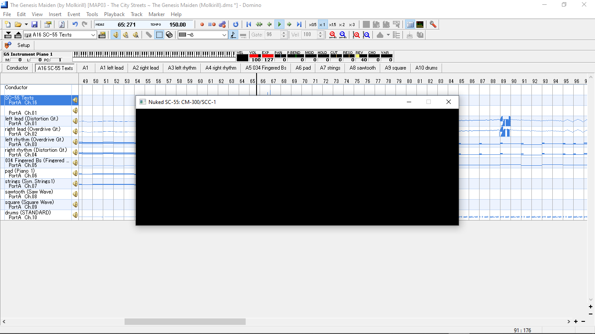

## Nuked-SoundCanvas tests

## 0.3.1

- SC-55mkI
	- Runs: yes
	- Runs in realtime: yes
	- Tested firmwares: `v1.00`, `v1.20`, `v1.21`, `v2.00`

- SC-55mkII (Firmware v1.01)
	- Runs: yes
	- Runs in realtime: no
	- SC-55st (v1.01): untested

- SC-155mkI:
	- Runs: yes
	- Runs in realtime: yes
	- Notes: ~~I have no idea how to communicate with it propery yet, so all MIDIs played over it are just piano and standard drum kit.~~ [1] For whatever reason, all settings related to receiving of messages were turned off so I had to switch them back on. [2] Just noticed the note on the Nuked SC-55 repo: `SC-155 doesn't reset properly on startup (firmware bug?), use Init All option to workaround this issue.`

- SC-155mkII:
	- Untested, no roms

- JV-880:
	- Runs: yes
	- Runs in realtime: yes
	- Tested firmwares: `v1.00`, `v1.01`
	- Notes: ~~Internal RAM read error when using internal performances.~~ <- Seems to be caused by lack of M-256E memory card emulation. Also `nuked.exe` fails to autodetect this romset.
	- Tested PCM Cards: none
	- Tested Expansions: none

- CM-300/SCC-1 (v1.10, v1.20):
	- Untested, incomplete set (lacks `R15199774` main MCU rom)

- SCC-1A:
	- Runs: yes
	- Runs in realtime: yes
	- Notes: lacks LCD:
	

- SCB-55/RLP-3194:
	- Untested, incomplete set (lacks `R15199827` main MCU rom)

- RLP-3237:
	- Untested, no rom set

- SC-55st (v1.01):
	- Untested

## jcmoyer's Nuked SC-55 v0.6.1
- SC-55mkI
	- Runs: yes
	- Runs in realtime: yes
	- Tested firmwares: `v1.00`, `v1.10`, `v1.20`, `v1.21`, `v2.00`, custom

- SC-55mkII
	- Runs: yes
	- Runs in realtime: almost (mkII), yes (st)

- SC-155mkI:
	- Runs: yes
	- Runs in realtime: yes
	- Notes: 
	  - For whatever reason, all settings related to receiving of messages are turned off on reset.

- SC-155mkII:
	- Untested, no roms

- JV-880:
	- Runs: yes
	- Runs in realtime: yes
	- Tested firmwares: `v1.00`, `v1.01`
	- Notes: ~~Internal RAM read error when using internal performances.~~ <- Seems to be caused by lack of M-256E memory card emulation. Also `nuked.exe` fails to autodetect this romset.
	- Tested PCM Cards: none
	- Tested Expansions: none

- CM-300/SCC-1 (v1.10, v1.20):
	- Untested, incomplete set (lacks `R15199774` main MCU rom)

- SCC-1A:
	- Runs: yes
	- Runs in realtime: yes
	- Notes: 
	  - Lacks LCD
		- Lacks the following drum sounds:
		  - Common:
				- #38 D-3 Snare Drum 1
  		  - #40 E-3 Snare Drum 2
  		  - #46 A#3 Open Hi-hat
				- #49 C#4 Crash Cymbal 1
  		  - #51 D#4 Ride Cymbal 1
  		  - #52 E-4 Chinese Cymbal
  		  - #53 F-4 Ride Bell
  		  - #55 G-4 Splash Cymbal
  		  - #57 A-4 Crash Cymbal 2
  		  - #58 A#4 Vibra-slap
  		  - #59 B-4 Ride Cymbal 2
  		  - #65 F-5 High Timbale
  		  - #66 F#5 Low Timbale
  		  - #86 D-7 Mute Surdo
  		  - #87 D#7 Open Surdo
		  - STANDARD SET (001) ROOM SET (009), JAZZ SET (033):
  		  - #41 F-3 Low Tom 2
  		  - #43 G-3 Low Tom 1
  		  - #45 A-3 Mid Tom 2
  		  - #47 B-3 Mid Tom 1
  		  - #48 C-4 High Tom 2
  		  - #50 D-4 High Tom 1
		  - POWER SET (017):
        - Following are present:
  		    - #38 D-3 Snare Drum 1
      - ELECTRONIC SET (025):
        - Following are present:
  		    - #38 D-3 Snare Drum 1
  		    - #40 E-3 Snare Drum 2
          - #58 A#4 Vibra-slap
      - TR-808 SET (026):
        - Following are present:
  		    - #38 D-3 Snare Drum 1
          - #46 A#3 Open Hi-hat
          - #49 C#4 Crash Cymbal 1
          - #58 A#4 Vibra-slap
      - BRUSH SET (041):
        - Following are present:
  		    - #38 D-3 Snare Drum 1
  		    - #40 E-3 Snare Drum 2
      - ORCHESTRA SET (049):
        - Following are present:
  		    - #38 D-3 Snare Drum 1
    		  - #40 E-3 Snare Drum 2
          - #59 B-4 Concert Cymbal 1
      - SFX SET (057):
        - (notes below 39 are not occupied) 
        - #72 C-6 Gun Shot
        - #78 F#6 Birds
        - #79 G-6 Rain
        - #82 A#6 Seashore
        - Following are present:
    		  - #40 E-3 Slap
          - #46 A#3 Metronome Bell
          - #49 C#4 Guitar Cutting Noise (up)
          - #51 D#4 Fl.key Click
          - #52 E-4 Laughing
          - #53 F-4 Screaming
          - #55 G-4 Heart Beat
          - #57 A-4 Footsteps 2
          - #59 B-4 Door Creaking
          - #65 F-5 Car Pass
          - #66 F#5 Car Crash
          - #86 D-7 Door Creaking
          - #87 D#7 Door Creaking
      I'll see if this is a partial issue (which it likely is) as some sounds lack one of their layer sounds

- SCB-55/RLP-3194:
	- Untested, incomplete set (lacks `R15199827` main MCU rom)

- RLP-3237:
	- Untested, no rom set

## Falcosoft's unknown version low-end build

- SC-55mkI
	- Runs: yes
	- Runs in realtime: yes
	- Tested firmwares: `v1.00`, `v1.20`, `v1.21`, `v2.00`

- SC-55mkII (Firmware v1.01)
	- Runs: yes
	- Runs in realtime: yes
	- SC-55st (v1.01): untested

- JV-880
	- Runs: no
	- Tested firmwares: `v1.00`, `v1.01`
	- Notes: It does launch just fine and all, showing some unknown writes in the console. However, the display is just always empty, and the module does not accept any MIDI data nor produce any sound.

- SC-155mkI:
	- Runs: yes
	- Runs in realtime: yes
	- Notes: ~~I have no idea how to communicate with it propery yet, so all MIDIs played over it are just piano and standard drum kit.~~ [1] For whatever reason, all settings related to receiving of messages were turned off so I had to switch them back on. [2] Just noticed the note on the Nuked SC-55 repo: `SC-155 doesn't reset properly on startup (firmware bug?), use Init All option to workaround this issue.`

- SC-155mkII:
	- Untested, no roms

- CM-300/SCC-1 (v1.10, v1.20):
	- Untested, incomplete set (lacks `R15199774` main MCU rom)
	- Based on SCC-1A, I assume this is just as broken

- SCC-1A:
	- Runs: yes
	- Runs in realtime: yes
  - Notes: Completely lacks the envelopes (both volume and pitch, pitch seen on `081 Square Wave` and `082 Sawtooth Wave`) emulation. If a drum sound is played, and is interrupted by new instance of itself, it mutes new incoming note events. [This](tests/nuked-sc55-tests_what_why) is how it sounds, compared to how I [expected](midis/Others/Molkirill/genmaid_55_demo.ogg) it to sound. Test song: "The Genesis Maiden" by Molkirill, MIDI version
- SCB-55/RLP-3194:
	- Untested, incomplete set (lacks `R15199827` main MCU rom)

- RLP-3237:
	- Untested, no rom set
